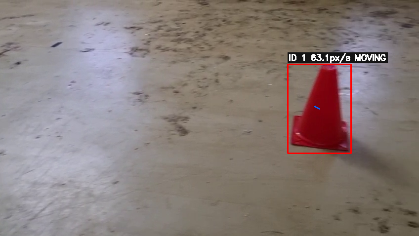

# Realtime Road-Object Stop Signal

This project uses trained YOLO11 detector and sign-classifier models to detect
road objects, classify relevant signs and traffic lights, estimate object
distance, annotate camera/video frames, and publish a ROS2 stop signal. Models
are loaded for inference; this runtime pipeline does not retrain them.

Detector classes are `barrier`, `cone`, `signBoard`, and `trafficLight`.
The sign classifier outputs `barrier_ahead`, `other`, and `stop`.

## Repository structure

```text
configs/       camera, object-size, model-role, and pipeline settings
src/           detector, classifiers, distance estimators, ROS2, and pipeline
src/extras/    bird's-eye homography, optical flow, and stereo depth demos
scripts/       run entry point, image test, and benchmark
weights/       trained checkpoints and exported ONNX model
data/          local datasets, calibration image, and test video
results/       image tests, benchmark reports, and extra-credit outputs
docs/          stereo epipolar derivation
```

## How to run

The existing ML and ROS2 environments are activated by the run script. From
the repository root, launch the live pipeline on camera index `0`:

```bash
./scripts/run_all.sh
```

Choose a video/image source or model variants and options as needed:

```bash
./scripts/run_all.sh --source data/videos/flow_test.mp4 --detector y11s --classifier sign_s --conf 0.35
```

`--source` accepts a camera index, video, image, or image folder. `--device auto`
selects CUDA when available; use `--no-display` for headless operation,
`--no-ros` for console-only output, `--save-video results/demo/live.mp4` to
record annotated frames, or `--max-frames N` to bound a run.

Run the held-out image test or reproduce the edge benchmark with the existing
environment:

```bash
source /home/marsuser/ml_env/bin/activate
python scripts/run_image_test.py --max-images 6
python scripts/benchmark.py
```

The image test writes annotated images and `results/demo/detections.csv`.
Benchmark artifacts are `results/benchmark.csv`, `results/benchmark.md`, and
`results/fps_comparison.png`.

## Distance estimation

Geometry range uses the pinhole-camera relation

```text
Z = f * H / h
```

where `Z` is estimated distance, `f` is focal length in pixels, `H` is the
configured real object height in metres, and `h` is the detected bounding-box
height in pixels. Width-based estimation uses the analogous known-width and
pixel-width quantities. Focal length is taken from `fx_px`/`fy_px`, derived
from sensor and lens dimensions, or estimated from the configured horizontal
field of view. Object dimensions are in [configs/object_sizes.yaml](configs/object_sizes.yaml).

The pipeline can also estimate depth using the configured depth model for
trigger frames. If both geometry and depth estimates are available, both are
shown; otherwise it displays whichever estimate is available. The geometry
method assumes an accurate object dimension and camera focal length, so its
accuracy is limited by the current uncalibrated camera configuration.

## Stop logic and ROS2

The pipeline asserts stop (`1`) if a frame contains a detected barrier, a red
traffic light, a sign classified as `stop`, or a sign classified as
`barrier ahead`; otherwise it publishes `0`. A `std_msgs/Int32` is published
for every processed frame to the configured `stop_signal` topic (ROS graph
name `/stop_signal`). Depth inference runs only on trigger frames.

Inspect messages and publish rate in another ROS2-sourced terminal:

```bash
source /opt/ros/humble/setup.bash
timeout 10 ros2 topic echo /stop_signal
timeout 10 ros2 topic hz /stop_signal
```

## Edge optimization

Hardware: **CPU:** AMD Ryzen 9 5950X 16-Core Processor; **GPU:** NVIDIA RTX
A4000. The benchmark used 50 fixed test images, 10 warmup inferences, and 40
timed inferences per configuration at `imgsz=640`, `batch=1`, `rect=False`.
Accuracy is mAP50 on the configured test split.

| Configuration | Device | Precision | Mean latency (ms) | FPS | mAP50 | Status / notes |
| --- | --- | --- | ---: | ---: | ---: | --- |
| y11s GPU | cuda:0 | FP32 | 5.9785 | 167.2674 | 0.965556 | measured |
| y11s CPU | cpu | FP32 | 61.9163 | 16.1508 | 0.965577 | measured |
| y11n GPU | cuda:0 | FP32 | 5.9626 | 167.7121 | 0.958561 | measured |
| y11n CPU | cpu | FP32 | 25.4075 | 39.3584 | 0.958549 | measured |
| y11n GPU | cuda:0 | FP16 | 5.8234 | 171.7221 | 0.958893 | measured; Ultralytics `quantize=16` |
| y11n ONNX | CPU | FP32 | 70.4948 | 14.1855 | — | ONNX Runtime; mAP50 not measured |
| y11n INT8 | — | INT8 | — | — | — | skipped; calibrated INT8 export path not configured |

Before optimization, y11s GPU FP32 measured 167.27 FPS at mAP50 0.9656.
Afterward, y11n GPU FP16 measured 171.72 FPS (1.03×) at mAP50 0.9589.
This is a small speed increase with a 0.0067 lower mAP50; y11n CPU FP32
measured 39.36 FPS. On the installed Ultralytics version, FP16 uses
`quantize=16`, the supported alternative to deprecated `half=True`.

## Extra credit

### Ground-plane homography

The four-point calibration is **not yet completed**: the reference image is
available at `data/calib/homography_ref.jpg`, but no user-selected calibration
points have been saved and no real bird's-eye result is claimed. To calibrate:

```bash
python -m src.extras.birdseye --select-points
```

Click top-left, top-right, bottom-right, bottom-left (clockwise from the far
edge); use `r` to reset and `s` to save. The output, once calibrated, is
`results/extras/birdseye_real.png`. The camera is uncalibrated and lens
distortion is ignored; this homography applies only to the flat plane of the
reference rectangle, becomes less accurate away from that plane, and requires
the camera to remain still.

### Global-motion-compensated optical flow



On `data/videos/flow_test.mp4`, automatic detection every third frame found the
cone at frame 36. The generated annotated clip is
`results/extras/optical_flow_real.mp4`, with per-frame pixel velocities in
`results/extras/optical_flow_real.csv`.

```bash
python -m src.extras.optical_flow --source data/videos/flow_test.mp4 --no-display
```

Lucas–Kanade object flow subtracts median background flow to approximately
compensate for camera shake. Velocity is in image pixels per second, not world
units. Camera motion may not be fully removed, and the method works best with a
mostly static camera. If automatic detection misses an object, use
`--roi x,y,w,h --start-frame N` or the interactive
`--select-roi --start-frame N` option.

### Stereo depth

[docs/epipolar_derivation.md](docs/epipolar_derivation.md) derives
`Z = fB/d`; [src/extras/epipolar.py](src/extras/epipolar.py) includes disparity
and depth conversions and a StereoSGBM demo. No real stereo image pair was
provided, so no stereo depth output is included.

## Limitations and TODO

- **Camera calibration is not done.** [configs/camera.yaml](configs/camera.yaml)
  still uses placeholder intrinsics and a 70° horizontal-FOV assumption;
  distortion is not calibrated.
- **Model pruning is not done.** The benchmark compares available model
  variants and precisions; it does not prune or retrain the trained weights.
- Object dimensions are approximate and should be measured for the target
  objects and environment.
- Geometry range is sensitive to camera focal length and object-size errors;
  stereo depth requires a calibrated, rectified camera pair.
- Homography is limited to its calibrated flat plane. Optical flow assumes a
  mostly static camera and reports pixel-space motion.
